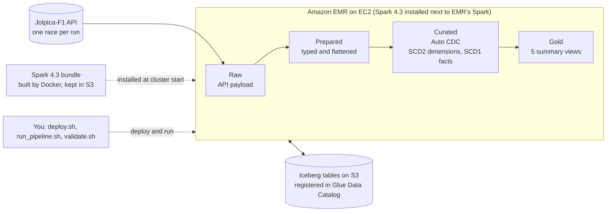

# AWS EMR + Spark 4.3 Declarative Pipelines (Auto CDC, SCD1 and SCD2)

Runs the F1 Spark Declarative Pipelines (SDP) project on **Amazon EMR on EC2 with Apache Spark 4.3**
and validates **Auto CDC** (`create_auto_cdc_flow`): SCD Type 2 history for the dimensions, SCD Type 1 for the facts. Ported from `f1-glue-sdp` (AWS Glue 6.0), where
the curated layer had to emulate "latest row per key" with `ROW_NUMBER()` materialized views.

Data comes from the **[Jolpica-F1 API](https://github.com/jolpica/jolpica-f1)** (the Ergast successor):
race results, qualifying and pit stops, one race per pipeline run.

- **Infra (CDK, Python)** – VPC with a private subnet + NAT, S3 bucket, ECR repo, IAM, Glue database, EMR cluster.
- **Docker builder** – builds the Spark 4.3 bundle (Spark tarball + Iceberg jars + Python venv); the image lives in the ECR repo.
- **Bootstrap action** – installs the bundle on every node at `/opt/spark-sdp`, next to EMR's own Spark.
- **Pipeline** – `pipeline/f1/`; the curated tables are Auto CDC flows.
- **Validation** – `scripts/validate.sh` runs the pipeline for two races, a re-run and three more races with real driver transfers (SCD2 history), and checks the results.

## Architecture



Each pipeline run reads one race from the API and pushes it through the four zones; Auto CDC keeps the curated tables up to date, with history for the dimensions.
Entity diagrams of every zone are in `docs/er-diagrams/`.

## Design notes

| Topic | Decision |
|---|---|
| EMR base | `emr-spark-8.0.0` (AL2023, Corretto 17, Python 3.11, Hadoop 3.4.2). EMR ships Spark 4.0.2 there, so Spark 4.3.0 is layered on via bootstrap action; EMR's Spark stays untouched. |
| Spark build | `spark-4.3.0-bin-without-hadoop`, using the node's own Hadoop classpath (YARN client, S3A). |
| Iceberg | `iceberg-spark-runtime-4.2_2.13` + `iceberg-aws-bundle`, **snapshot build `1.13.0-20261108.001937-52`** from Apache's snapshot repo, pinned in `docker/Dockerfile.builder`. There is **no Iceberg runtime for Spark 4.3** (none on Maven Central or in the snapshot repo; Iceberg PR #18749 "Initial support for Spark 4.3" is open), and released Iceberg (1.12.0) has none for 4.2 either (its 4.1 runtime fails on Spark 4.2 with `IncompatibleClassChangeError`). So Spark 4.3 runs with the Spark 4.2 snapshot runtime; `docker/build_bundle.sh` smoke-tests that pairing (a local Iceberg table with `MERGE INTO`/`DELETE`) before the bundle is packaged. Move to a 4.3 runtime when one ships. |
| Auto CDC scope | **SCD Type 2** for `dim_drivers`, `dim_teams`, `dim_circuits` (history; Spark 4.3 `stored_as_scd_type=2`, versions bounded by `__START_AT`/`__END_AT`, current version has `__END_AT NULL`); **SCD Type 1** for the three facts. Spark 4.2 supports SCD1 only, which is why the project moved to 4.3.0. SCD2 is documented in the Spark docs only from 4.3.1 / 4.4.0 (SPARK-58570), so the behaviour here is confirmed by the validation run. |
| Cluster | 1 on-demand primary + 2 on-demand core `m5.xlarge` (Spot core nodes are not the default: see Troubleshooting), auto-terminates after 1 h idle. `emr-spark-8.0.0` offers nothing below `xlarge` (no `t2`/`t3`/`.large`). Cheaper presets below. Change via `infra/cdk.json` or `-c key=value`. |
| Network | Private subnet, one NAT gateway (the Jolpica API is called from the cluster), S3 gateway endpoint, EMR service interface endpoint required by `emr-spark-8.0.0`. In a private subnet EMR requires the primary, core and service-access security groups to be supplied together, so the platform stack creates all three (primary/core allow all traffic between and within themselves). |

## Data zones

| Zone | File | Tables |
|---|---|---|
| Raw (bronze) | `01_bronze_raw.py` | `raw_results`, `raw_qualifying`, `raw_pitstops`: the API payload as returned (all values strings) plus lineage columns. The flows read the API **directly** through a PySpark Python Data Source (`f1_pipeline_lib/f1_source.py`, format `f1_api`): one run reads one race from each endpoint, once, as a single-row stream. Nothing is staged in S3; the source's offset in the pipeline checkpoint (`storage:`) is what makes it once per run. `circuit_track_type` (static CSV reference data) is a second, independent source. |
| Prepared | `02_bronze_prepared.py` | Flattened and typed: `race_results_unnested`, `race_qualifying_unnested`, `race_pit_stops`, `race_drivers`, `race_teams`, `race_circuits`. `race_Id = <season>_<round>` (the API has none); lap times become milliseconds. |
| Curated (silver) | `03_curated.py` | Six Auto CDC tables (SCD2 for three dimensions, SCD1 for the rest), below. |
| Modelled (gold) | `04_gold.sql` | `driver_performance_summary`, `team_performance_summary`, `circuit_summary`, `qualifying_vs_race_summary`, `pit_stop_summary`. |

Auto CDC tables (`pipeline/f1/transformations/03_curated.py`):

| Table | SCD | Source | Keys | `sequence_by` |
|---|---|---|---|---|
| `dim_drivers` | 2 | `race_drivers` | `driver_Id` | `race_Date` |
| `dim_teams` | 2 | `race_teams` | `team_id` | `race_Date` |
| `dim_circuits` (enriched with `track_type`) | 2 | `circuits_enriched` view | `circuit_Id` | `race_Date` |
| `fact_race_results` | 1 | `race_results_unnested` | `race_Id`, `driver_Id` | `refreshed_at` |
| `fact_qualifying` | 1 | `race_qualifying_unnested` | `race_Id`, `driver_Id` | `refreshed_at` |
| `fact_pit_stops` | 1 | `race_pit_stops` | `race_Id`, `driver_Id`, `stop` | `refreshed_at` |

`refreshed_at` (the bronze load time, carried through the raw and prepared zones) orders the events for the facts. No curated table keeps it
(`except_column_list`); Auto CDC records the sequence it used in the hidden `__spark_autocdc_metadata.upsertSequence`. The SCD2 tables order by
`race_Date`.

`dim_circuits` joins a *static snapshot* of `circuit_track_type` to the stream of circuits, so load
the initial reference CSV before the first race run (`--upload-reference-data initial`); the incremental one is loaded before a later run
(`--upload-reference-data incremental`, done by `validate.sh` before race 2) and the streaming table picks up only that new file. Entity
diagrams of every zone are in `docs/er-diagrams/`.

**Data source terms.** Jolpica data is licensed **CC BY-NC-SA 4.0 (non-commercial)** and derived from Ergast;
credit "Jolpica-F1 / Ergast" when sharing results. The service is volunteer-run with no uptime guarantee,
limits of **4 requests/second and 500/hour** (a race run makes 3 calls, a full validation about 12), and
requires a descriptive `User-Agent` (`spark.f1.api.user_agent` in `pipeline/f1/spark-pipeline.yml`). The fetcher
pauses between calls and retries `429`/`5xx` with backoff.

## Layout

```
infra/        CDK app (platform stack, cluster stack, cdk.json settings)
docker/       Dockerfile.builder, build_bundle.sh (runs in the container), Spark conf
bootstrap/    install_spark.sh (EMR bootstrap action) and EMR step helpers
scripts/      deploy / build / run / validate / destroy
pipeline/f1/  the SDP project (spark-pipeline.yml, transformations/, f1_pipeline_lib/)
validation/   env_check.py, verify.py (run on the cluster), report.py (local)
presentation/ the DEV community article about this project (draft, with screenshot placeholders)
reference_data/, docs/, tests/
```

## Prerequisites

AWS CLI, Docker, Node.js + `aws-cdk` CLI, Python 3.11+. An AWS profile with admin-like rights in the
target account (`us-east-1` by default; set your profile name in `P` below).

**Choose the account deliberately.** The scripts run against whatever account your profile resolves to and
print it first (`Using profile=... account=... region=...`). Check that line before continuing: the stacks
create a NAT gateway, an interface endpoint, an ECR repo, an S3 bucket, IAM roles and an EMR cluster there.

```bash
python3 -m venv .venv && source .venv/bin/activate
pip install -r requirements-dev.txt
pytest tests            # unit + CDK assertion tests
```

## Runbook

```bash
P=<your-aws-profile>

scripts/deploy.sh               --profile $P --stage platform   # VPC, S3, ECR, IAM, Glue DB (bootstraps CDK if needed)
scripts/build_and_push_image.sh --profile $P                    # builder image -> ECR
scripts/build_bundle.sh         --profile $P                    # runs the image (~5-10 min), uploads the bundle to S3; add --skip-build to upload an existing one
scripts/deploy.sh               --profile $P --stage cluster    # EMR cluster (bootstrap installs the bundle)

scripts/validate.sh             --profile $P                    # end-to-end validation -> docs/validation-report.md

scripts/run_pipeline.sh --profile $P --season 2024 --round 3 --wait   # run another race
scripts/destroy_cluster.sh      --profile $P                    # only the EMR cluster (same as destroy.sh --stage cluster)
scripts/destroy.sh              --profile $P                    # everything: cluster, then platform (--stage cluster|platform|all)
```

### What `scripts/validate.sh` does

`validate.sh` proves, on the real cluster, that the pipeline and Spark 4.3 Auto CDC behave correctly. It ingests real races from the
Jolpica API one after another, and after the important ones it compares the curated tables with an independently computed
expectation. Nothing is simulated.

```bash
scripts/validate.sh --profile $P [--season 2024] [--rounds 1,2]    # HISTORY=0 skips the history phase
```

**Before you run it.** A cluster must be running (`deploy.sh --stage cluster`). The script does not clean anything, so it expects an
**empty pipeline**: no tables in the Glue database, nothing under `s3://<bucket>/f1-pipeline/{warehouse,state,validation/results}/`,
and no reference CSVs in `.../reference-data/circuit_track_type/`. On a used pipeline, the "one race ingested" and "reference data
grew" checks fail. To start over, delete those tables and prefixes (or use a new database/prefix).

**Order of ingestion.** Each pipeline run ingests exactly one race. Every `verify` step is a Spark job on the cluster that reads the
tables and writes `<label>.json` to `s3://<bucket>/f1-pipeline/validation/results/`.

| # | Step | Race (season/round) | Reference data loaded | Then |
|---|---|---|---|---|
| 0 | Environment check | none | none | `env.json`: Spark 4.3.x, Java 17+, Python 3.11+, YARN, Glue catalog visible, `create_auto_cdc_flow` with SCD2 options available |
| 1 | Dry run | none (validates the pipeline definition) | `initial` CSV | none |
| 2 | Race 1 | 2024 / 1 | none | verify `r1` |
| 3 | Race 2 | 2024 / 2 | `incremental` CSV, uploaded first | verify `r2` |
| 4 | Race 2 again | 2024 / 2 | none | verify `r2_rerun` |
| 5-7 | History races (in date order) | 2024 / 24, then 2025 / 1, then 2025 / 3 | none | verify `history` after the last one |
| 8 | Report | none | none | download the results, run `validation/report.py`, write `docs/validation-report.md` |

Steps 2-4 test Auto CDC on a small scale: first load, an upsert of a new race, and idempotence (re-ingesting the same race must change
nothing). Steps 5-7 give the SCD2 dimensions real changes, because Jolpica's own attributes never change but drivers change
team (see "The F1 API as a CDC source" below). The final state has five distinct races: 2024 R1, R2, R24 and 2025 R1, R3.

**What is checked** (`verify.py` on the cluster computes the numbers, `report.py` on your laptop turns them into pass/fail):

| Area | Checks |
|---|---|
| Every curated table (six) | Rows exist. Exactly one row per key (SCD2: exactly one *current* version per key). Parity: the table equals a plain "latest row per key" window computed over the prepared tables, i.e. what Auto CDC should have produced. |
| SCD1 facts (three) | `__spark_autocdc_metadata.upsertSequence` of each row equals the sequence value of its latest source row. |
| SCD2 dimensions (three) | Versions of a key are contiguous (each `__END_AT` equals the next `__START_AT`, only the last is open). The first version starts at the earliest source sequence. |
| Growth and idempotence | `fact_race_results` grows after race 2. After the re-run, every table has the same rows and content hash (`r2` vs `r2_rerun`), and the reference table is not reloaded. |
| History (`[history]`) | Hamilton, Sainz, Tsunoda, Lawson and Ocon have exactly the expected team versions in order (for example Lawson: `rb`, `red_bull`, `rb`), each closed version ends where the next starts, and every other multi-version driver is a real transfer. |
| Data sanity | `fact_race_results` has a result for every ingested race, every result has a driver and a team, every winner has a race time, at least 90% of qualifiers have a Q1 time, every pit stop has a parsed duration, every circuit has a `track_type`, and the incremental reference file grew `circuit_track_type`. |
| Gold | All five gold views are populated. |
| Environment | The checks from `env.json` (step 0), left out only if you pass `--skip-env` to `report.py`. |

**Result.** The report lists every check as PASS or FAIL with its detail and the overall count, in `docs/validation-report.md`
(also printed). `validate.sh` exits with a non-zero status if any check fails. A pipeline run that fails stops the script at that step. A
failed run leaves the stream offset unchanged, so you can run that same race again with `scripts/run_pipeline.sh ... --wait` and
carry on by hand with `verify` and the later steps, or fix the cause (see Troubleshooting) and start over on a clean pipeline.
The downloaded result files are in `build/validation-results/`.

## Troubleshooting

- **Pipeline flow fails with `f1.season.year and f1.season.round are both required` (also in a dry run), although you passed
  `--conf spark.f1.season.year=...`** – `spark-submit --conf` settings are not visible to the flows: they read `spark.conf`
  from the Spark Connect session, which `spark-pipelines` builds only from the spec's `configuration:` block.
  `bootstrap/run_pipeline_step.sh` therefore copies every `--conf spark.f1.*=...` argument (and `spark.f1.job.mode=VALIDATE` for
  dry runs) into that block in a per-run copy of the spec. Other `--conf` arguments still go to spark-submit. Anything new that
  a flow reads with `spark.conf.get(...)` must be passed the same way.

- **Dry run / pipeline run fails with `TypeError: unsupported operand type(s) for |` (in `pyspark/sql/types.py`) and `Remote
  cannot be specified with master and/or deploy mode`** – `spark-pipelines` locates its CLI with `$PYSPARK_PYTHON` (default
  `python3`, 3.9 on AL2023, too old for PySpark 4.3) and always adds `--remote local` (Spark Connect), which Spark rejects
  together with a master from `spark-defaults.conf`. `bootstrap/run_pipeline_step.sh` therefore pins `PYSPARK_PYTHON` to the
  bundled Python 3.11 and runs with a copy of the conf without `spark.master` / `spark.submit.deployMode`. Consequence: pipeline
  runs execute in a local Spark Connect server on the primary node (4 GB driver), not on YARN; plain `spark-submit` steps
  (env check, verify) still run on YARN. To use YARN for pipelines, start a Spark Connect server on YARN and pass
  `--remote sc://<host>:15002`.

- **`add-steps` fails with `A job flow that is shutting down, terminated, or finished may not be modified`, but the cluster was fine
  earlier** – check `aws emr list-clusters --profile $P --region us-east-1`: `Terminated according to the attached auto-termination
  policy after 3600 idle seconds` means the cluster sat idle for the `idle_timeout_seconds` window (default 1 h). Data in Glue/S3 is
  untouched. Run `scripts/destroy_cluster.sh`, then `scripts/deploy.sh --stage cluster` (add `-- -c idle_timeout_seconds=28800` for a
  long session), and use the new cluster id (`source scripts/step_helpers.sh; init_env` re-reads it).

- **`report.py` fails with `FileNotFoundError: ... env.json`** – the environment check step never succeeded, so its result was never
  written. Run `scripts/run_spark_script.sh --profile $P validation/env_check.py --bucket $BUCKET --prefix f1-pipeline --database $DATABASE`
  while a cluster exists, or pass `--skip-env` to `validation/report.py` once the cluster is gone (the report then says the
  Spark/Java/YARN versions were not verified).

- **`deploy.sh --stage cluster` says "the bundle in S3 is not your latest local build"** – you rebuilt the bundle but did not
  upload it, so a new cluster would install the old one. Run `scripts/build_bundle.sh --profile $P --skip-build`, then deploy.
  (`ALLOW_STALE_BUNDLE=1` bypasses the check.) The cluster installs the bundle at launch, so a running cluster never picks up
  a new one: destroy and recreate it.

- **`IncompatibleClassChangeError: class org.apache.iceberg.spark.SparkView can not implement
  org.apache.spark.sql.connector.catalog.View`** – the Iceberg runtime was built for a different Spark minor version
  (a Spark 4.1 runtime on Spark 4.2). Use the `iceberg-spark-runtime-4.2` build (see the design table), rebuild the bundle,
  upload it and create a new cluster: jars are installed by the bootstrap action, so a running cluster keeps the old ones.

- **A step logs `Running Spark version 4.0.2-amzn-0`, or `ImportError: cannot import name 'pipelines' from 'pyspark'`
  (path under `/usr/lib/spark`)** – the step ran EMR's own Spark, not 4.3: EMR's step environment sets `SPARK_HOME` and
  `PYTHONPATH`, and `spark-submit` honours them. `bootstrap/run_*_step.sh` and the `spark-sdp-*` wrappers now pin
  `SPARK_HOME=/opt/spark-sdp` and drop EMR's `PYTHONPATH`. To pick up a script change on a running cluster, copy it to
  `s3://<bucket>/f1-pipeline/bootstrap/` (or redeploy the platform stack); the wrappers only change on new clusters.

- **`BOOTSTRAP_FAILURE ... bootstrap action 1 returned a non-zero return code`** – read the node's bootstrap log:
  `aws s3 cp s3://<bucket>/f1-pipeline/emr-logs/<cluster-id>/node/<instance-id>/bootstrap-actions/1/stderr.gz - | gunzip | head`
  (delivered a few minutes after the failure; the instance id is in the error). Bootstrap actions run as the `hadoop` user, not
  root, so `install_spark.sh` uses `sudo` for anything under `/opt`, `/etc` or `/usr/local`. After editing a script in
  `bootstrap/`, redeploy the platform stack (it syncs that folder to S3), then the cluster stack.

- **Dry run fails with `[USER_SPECIFIED_AND_INFERRED_SCHEMA_NOT_COMPATIBLE] ... raw_pitstops` and an inferred
  `season_requested: void`** – in a dry run `season`/`round` are not set, and a `lit(None)` lineage column is a NULL-typed column
  that cannot match the declared non-null string. The raw flows now always use real strings (empty in a dry run) and require
  season/round for real runs.

- **Raw tables: the flow fails inside the `f1_api` data source (HTTP error, `429`, timeout)** – the API is called from a Python
  worker on the primary node during the update, so its errors appear in the step's stderr/stdout. There is no retry of the whole
  run: fix the cause (Jolpica limits: 4 requests/second, 500/hour) and run the step again; a failed run leaves the stream offset
  unchanged, so the retry fetches the race again.

- **Cluster `TERMINATED_WITH_ERRORS`, reason `INSTANCE_FAILURE: All slaves in the job flow were terminated due to Spot`, and
  `add-steps` answers `A job flow that is shutting down, terminated, or finished may not be modified`** – the Spot core nodes
  were reclaimed (here two minutes after the cluster reached `WAITING`) and EMR ends the whole cluster when it loses every core
  node, even though the on-demand primary was healthy. Check with `aws emr list-instances --cluster-id <id>` (`Spot Instance was
  terminated`). Core nodes are therefore on-demand by default (`core_market` in `infra/cdk.json`); use `-- -c core_market=SPOT`
  or a Spot primary only when losing the cluster is acceptable. Delete the dead cluster stack and deploy again
  (`scripts/destroy_cluster.sh`, then `scripts/deploy.sh --stage cluster`).

- **`Service-linked role 'AWSServiceRoleForEC2Spot' ... is required`** – a brand-new account has never used Spot, so the
  role doesn't exist yet. The platform stack now lets the EMR service role create it. To fix an account right away
  without redeploying: `aws iam create-service-linked-role --aws-service-name spot.amazonaws.com --profile $P`
  (an "already exists" error means it is fine). Then delete the failed cluster stack and redeploy it.

- **`EmrPrimarySg` / `EmrCoreSg` `DELETE_FAILED ... has a dependent object`** – EMR adds its own rules between the primary
  and core security groups at runtime, so each group references the other. `scripts/destroy.sh` now revokes those
  group-to-group rules before deleting the platform stack. If a stack is already stuck in `DELETE_FAILED`, revoke them by
  hand (`aws ec2 describe-security-group-rules` / `revoke-security-group-ingress --security-group-rule-ids ...`) and run
  `aws cloudformation delete-stack --stack-name EmrSdpPlatformStack` again.

- **`Service role ... has insufficient EC2 permissions`** – the real denial is in CloudTrail (`ec2:RunInstances` ...
  `not authorized to perform: iam:PassRole`). The platform stack now lets the service role pass the instance role to
  EC2. Redeploy the platform stack, then the cluster stack.
- **Two `emr-service-cell01` VPC endpoints in the VPC** – if EMR created its own (private DNS on), it is not part of the
  CloudFormation stack and blocks `cdk destroy` of the VPC. List them with `aws ec2 describe-vpc-endpoints --filters
  Name=service-name,Values=aws.api.<region>.emr-service-cell01`, delete the one without the
  `aws:cloudformation:stack-name` tag, then redeploy the platform stack (ours now has private DNS on, so EMR reuses it).

- **`cdk bootstrap` is shared, account-level infrastructure** (staging S3 bucket, container-assets ECR repo, IAM
  roles; stack `CDKToolkit`). `scripts/deploy.sh` only runs it when `CDKToolkit` is missing, or with `--bootstrap`.
  Accounts with resource-creator or tagging policies may flag those bootstrap resources: check
  `aws cloudformation describe-stacks --stack-name CDKToolkit` first, and ask the account owner before
  bootstrapping or re-bootstrapping a shared account.

- **`EmrManagedMasterSecurityGroup and EmrManagedSlaveSecurityGroup must be specified ...`** – fixed by the
  primary/core security groups in the platform stack. Re-run `scripts/deploy.sh --stage platform`, then
  `--stage cluster`. If the cluster stack is stuck in `ROLLBACK_COMPLETE` from the failed attempt and `cdk deploy`
  refuses to continue, delete it first: `scripts/destroy.sh --profile $P --keep-platform`.
- **Slow or silent bundle download** – use `scripts/build_bundle.sh --skip-build` to upload an already-built bundle.
- **`jsii` "untested Node version" banner** – harmless; silence with `export JSII_SILENCE_WARNING_UNTESTED_NODE_VERSION=1`.

## Cost

NAT gateway, interface endpoint, EMR instances and S3/ECR storage are billable. The cluster ends itself
after the idle timeout. `scripts/destroy_cluster.sh` removes just the cluster stack (keeps VPC/NAT/S3/ECR and your
tables); `scripts/destroy.sh` removes everything, which is what stops the NAT and endpoint billing.

### Cheaper cluster presets

Pass the preset to the cluster stage:

| Preset | Command suffix | Approx. compute per hour |
|---|---|---|
| default | (none) | ~$0.72 (on-demand primary + 2 on-demand core) |
| Spot core (can end the cluster at any time) | `-- -c core_market=SPOT` | ~$0.46 |
| one core node | `-- -c core_instance_count=1` | ~$0.48 |
| long dev session | add `-c idle_timeout_seconds=28800` | idle time is billed |

e.g. `scripts/deploy.sh --profile $P --stage cluster -- -c idle_timeout_seconds=28800`.
Prices are us-east-1 list/Spot prices as of 2026-11-08; the NAT gateway and interface endpoint (~$0.055/h) bill on top
until the platform stack is destroyed.

## The F1 API as a CDC source

Jolpica is a **snapshot API**: every call returns the current state, with no change feed, no updated-at field, no delete markers
and no ETags. So the pipeline treats each fetch as a set of upsert events (sequenced by `race_Date` for dimensions, by load time for
facts) and processes the data exactly as the API returns it. Nothing is simulated or modified. Where real changes would appear:

- **Post-race amendments** (penalties, disqualifications, corrected points, revised pit stops): re-fetching the race overwrites the
  result row (SCD1 fits; the old value is not needed).
- **Dimension history**: a driver's team changes between seasons (and sometimes within one), which is worth keeping as history, hence
  SCD2 for `dim_drivers`; constructors and circuits are SCD2 too but the API never changes their attributes.
- **Not covered**: a row that disappears upstream. Nothing tells us, so deletes would have to be derived by diffing a fresh fetch
  against what is stored; Spark's Auto CDC has no "from snapshot" mode. `apply_as_deletes` is therefore not used.

Jolpica's own dimension attributes (driver names, code, number, nationality; constructor and circuit names and locations) never
change: probing round 1 of 15 seasons between 1996 and 2025 found no difference for any driver, constructor or circuit id. What
does change in the real history is **which team a driver races for**. So `race_drivers` carries the driver's `team_id` for each
race and `dim_drivers` (SCD2, `team_id` tracked) opens a new version on every transfer. `scripts/validate.sh` therefore ends with
a history phase that ingests, in date order, 2024 round 24 and 2025 rounds 1 and 3 on top of 2024 rounds 1 and 2 (set `HISTORY=0` to
skip it). Nothing is simulated: the API returns, over those five races, Hamilton Mercedes to Ferrari, Sainz Ferrari to Williams,
Ocon Alpine to Haas, Tsunoda Racing Bulls to Red Bull and Lawson Racing Bulls to Red Bull and back (three versions), plus
Bearman (Ferrari stand-in, then Haas). `report.py` checks those histories: one version per team stint, each closed version's
`__END_AT` equal to the next `__START_AT`, the last one open. Constructors and circuits stay at one version each.

## Known limits

- **Jolpica dependency.** The raw zone calls the public Jolpica API at run time (non-commercial terms, volunteer-run, limits that the
  maintainers say will decrease). Tests use captured fixtures in `tests/fixtures/jolpica/` and never call it. The original source
  `f1api.dev` was shut down (HTTP 402 `DEPLOYMENT_DISABLED`) and has been removed from the code.
- Jolpica has no team championships, circuit length/corners/lap record or race ids; the model derives `race_Id`, drops those columns
  and computes the circuit's fastest lap from the ingested races.
- Deletes (`apply_as_deletes`) are not exercised: the F1 data has none and Jolpica has no change feed.
- The Iceberg runtime in the bundle was built for Spark 4.2 (an unreleased snapshot, pinned) and runs on Spark 4.3; the builder's smoke test and the validation run are what show whether Auto CDC merges work on it.
- SCD2 in Spark 4.3.0 is new: tracking-column evolution (SPARK-58452) and some ignore-null cases are still open upstream, and only the basic path (`track_history_except_column_list`) is used here.
- Nothing in this repository is committed or pushed by the tooling.
