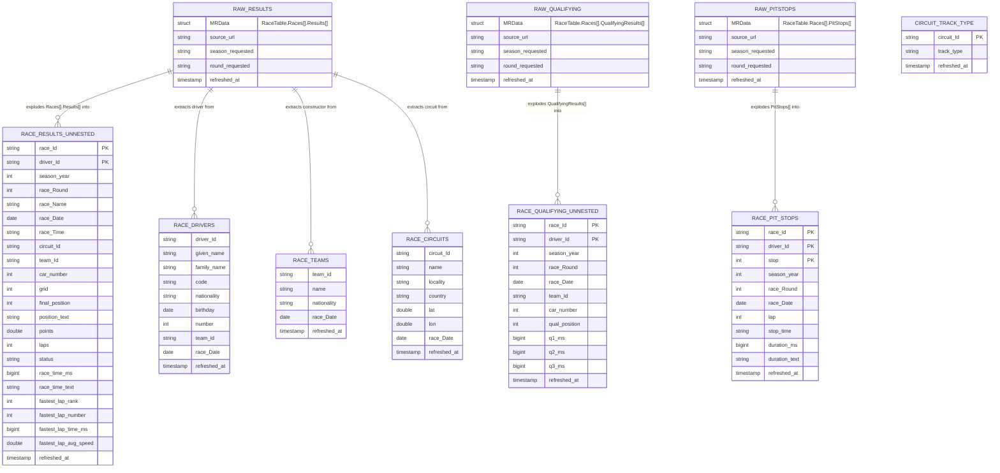

# Bronze layer -- ER diagram

Source: `pipeline/f1/transformations/00_bronze_circuit_track_type.py`, `01_bronze_raw.py`, `02_bronze_prepared.py`.

Raw = one streaming table per Jolpica endpoint (payload as returned, every value a string, plus lineage
columns), read straight from the API by a PySpark Python Data Source (`f1_api`, no files staged in S3). Prepared = the same data flattened and typed, one table per grain; `race_Id` is derived as
`<season>_<round, 2 digits>` because the API has no race id. `circuit_track_type` is deliberately drawn
with no relationship to the raw tables: it is the second, independent, non-API source (static CSVs) and
only joins the graph in the curated layer, via `dim_circuits`.

Every raw and prepared table (and `circuit_track_type`) carries `refreshed_at`, the time the row was loaded. The curated facts
use it as their Auto CDC sequence (a re-run of a race overwrites the earlier load) and then drop it, so it is not visible in the
curated or gold tables.

Parsing rules (all through `try_cast` / regex-guarded expressions, so a bad value becomes NULL instead
of failing the run, because ANSI mode is on): lap and qualifying times (`1:24.350`, `1:33:56.736`,
`23.456`) become milliseconds; `+gap` strings and `R`/`D` become NULL; `race_time_ms` comes from the
API's `Time.millis`.
