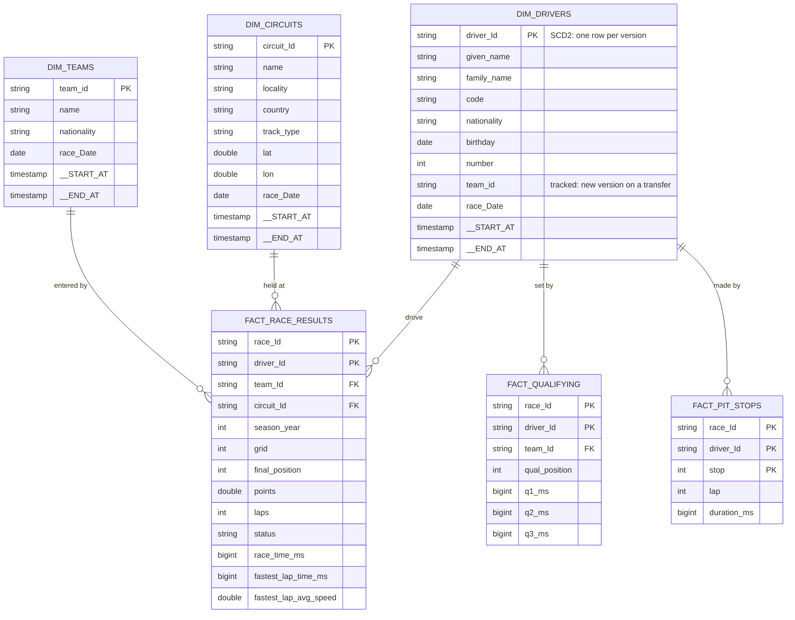

# Curated layer -- ER diagram

Source: `pipeline/f1/transformations/03_curated.py`.

All six tables are built with Spark 4.3's Auto CDC (`dp.create_auto_cdc_flow`):

- `dim_drivers`, `dim_teams`, `dim_circuits` are **SCD Type 2** (`stored_as_scd_type=2`): one row per *version* of an entity.
  Auto CDC adds `__START_AT` and `__END_AT`; the current version has `__END_AT IS NULL`. A new version opens only when a tracked
  attribute changes (`track_history_except_column_list=[race_Date]`; the sequence column itself is not tracked). The gold zone reads
  `dim_*_current` views (open versions only). Primary key below is the entity key; a key appears once per version.
- The three facts are **SCD Type 1** (latest state only, `stored_as_scd_type=1`).

Each target is declared with no schema because Auto CDC adds hidden columns (`__spark_autocdc_metadata` with `deleteSequence` and
`upsertSequence`; for SCD2 also the version bounds) to it. Sequencing: dimensions by `race_Date` (a later race wins),
the facts by `refreshed_at`, the bronze load time (a re-run overwrites the earlier load). `refreshed_at` only orders
events, so no curated table keeps it; Auto CDC records the sequence it used in the hidden `__spark_autocdc_metadata.upsertSequence`.
The SCD2 tables mark when a version began in `__START_AT`.

`dim_circuits` carries `track_type`, joined in from the second, independent bronze source
`circuit_track_type` (stream-static join, left join: a circuit without a classification keeps
`track_type = NULL`). Load the reference CSVs before the first race run.

(Only the main columns are drawn; `fact_race_results` also carries `race_Round`, `race_Name`, `race_Date`,
`race_Time`, `position_text`, `race_time_text`, `fastest_lap_rank`, `fastest_lap_number`, `car_number`.)
