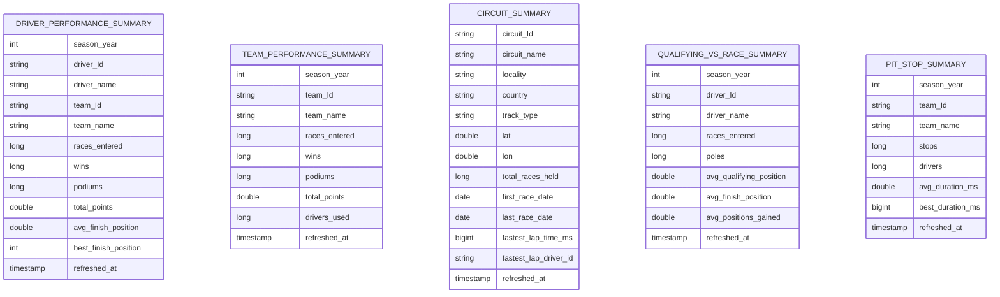

# Gold (modelled) layer -- ER diagram

Source: `pipeline/f1/transformations/04_gold.sql`.

Five denormalized materialized views, no foreign keys between them, each aggregated straight from the
curated Auto CDC tables. The three dimensions are SCD Type 2 (one row per version), so the views read them through the
`dim_drivers_current`, `dim_teams_current` and `dim_circuits_current` temporary views (open versions only, `__END_AT IS NULL`);
joining the history rows would multiply every fact row by the number of versions. Here `refreshed_at` is the time the view was
computed (`current_timestamp()`), not the bronze load time. `circuit_summary` carries `track_type` from `dim_circuits`, proving the second
bronze source reaches gold; its fastest lap is computed from the ingested races (Jolpica has no circuit lap
record). `pit_stop_summary` excludes stops over 60 s as red-flag outliers; `positions_gained` is
`qual_position - final_position` (positive = finished ahead of the qualifying position).

